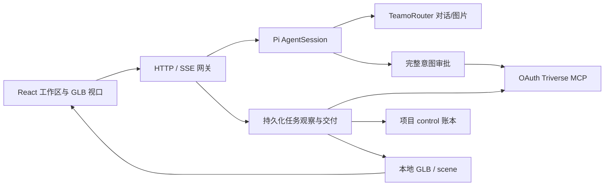

# 架构

最后更新：2026-10-09。当前实现入口为 `apps/` 与 `packages/`。

## 组件

单进程、单所有者。项目按 UUID 分目录，Pi 会话按项目复用；模型变更/重新登录后销毁旧会话。Pi 扩展显式加载 MCP、秘密脱敏与审批，禁止其他默认扩展。默认技能加载关闭，仅加载项目技能目录。

## 模型与工具

对话模型列表由 protocol 包定义；Claude 走 Anthropic messages，其他模型走 OpenAI completions。Pi 的静态 context/maxTokens/cost 元数据是兼容配置，零 cost 不代表服务免费；实际账单以服务为准。

本地工具包括 read/write/edit、条件可用的 bash、inspect_asset/list_workspace_files、read_scene/update_scene/add_scene_asset、save_asset_version/export_asset_pack、request_creation_approval、upload_reference/sync_tasks/deliver_asset、generate_image。远程名称统一 `mcp__triverse__<name>`，实际 tools/list 与 schema 为准。

宿主上传与导出工具使用相同 MCP OAuth 身份，没有直接 Triverse 业务 API 回退。模型直接调用 prepare/finalize upload 和 export_model 会被阻止，防止泄露上传租约或绕过持久化导出意图。

## 付费与恢复

quote/create 分离。报价收据保存到受保护 control；本地审批工具校验实际 JSON schema、默认参数、报价一致性、完整 prompt/source、明确 visibility、operation UUID 与精确 max credits。

HTTP 批准后，执行钩子原子消耗 grant 并在发送 create 前登记 operation。重复/修改/过期/并发使用均拒绝。返回未知时仅查询同一 operation，后台不会重新创建。旧 confirm 协议兼容保留，但当前 23 工具不依赖它。

后台 15 秒扫描持久化 operations，调用 get_operation/refresh_task，记录结果、结算和 recovery action。完成结果建立独立 export intent 与页面审批；获准后 export_model 仅发送一次。未知结果 get_export 同 ID，转换失败不会自动付费重试。

下载仅接收公开 HTTPS，DNS 地址固定、防私网/重定向、限时限量。大小/哈希存在时严格验证，检查自包含 GLB 后以内容哈希保存、登记历史与幂等场景对象。缺少原始 GLB 或不明确候选会报告失败，不默默转换。

## 场景与历史

protocol 校验场景：有限变换、正缩放、唯一 ID、有效层级/引用；场景修改以 expectedVersion 防覆盖，并串行原子写入。视口使用真实变换与模型包围盒，支持没有默认 scene 的 mesh 库 GLB fallback、视口级错误保护、相机预设、选中框、层级、灯光、模式、动画与 PNG。

save_asset_version 保存独立 GLB 与当时场景快照；版本索引放 control。本地 ZIP 包含 GLB、裁剪后的 scene、manifest、哈希、面数预算和审查警告。历史比较在两个视口展示当前场景与选定历史资产。

inspect_asset 解析 GLB 二进制和节点变换，区分三角形/strip/fan，检查 UV、法线、蒙皮、动画及有界拓扑。压缩、稀疏、外部 buffer、大规模几何会标记审查不完整，不给出打印认证。

## 技能加载

8 个技能及依赖在 skills/catalog.json。完整目录资源按内容哈希同步，退役的 110 个技能副本清理，自定义技能保留；缺工具的技能禁用自动调用，Capabilities 显示状态和缺失工具。不存在远程 remesh/render 时不会伪装成功。

## 存储和执行边界

control 在 workspace 外；通用文件工具校验 realpath，拒绝越界和符号链接逃逸。内部 .triverse、AGENTS、scene JSON、版本和生成结果禁止通用写入。下载 API 不公开内部元数据，HTML/JS/SVG 作为下载附件并加 sandbox CSP。

Shell 要求可运行的系统沙箱：macOS sandbox-exec 或 Linux bubblewrap。没有隔离则不注册 bash；子进程不继承凭据/启动脚本，网络关闭、系统目录只读、项目控制目录不可见。

对外监听必须配置访问密钥。登录建立 8 小时 HttpOnly SameSite=Strict cookie；变更请求校验 Origin；无密钥本地 API 要求 loopback Host，防止 DNS 重绑定。该实现保护共享所有者工作区，不提供多人权限隔离。

JSON 使用临时文件+rename 原子落盘，解析损坏不会被空记录掩盖。聊天快照复制后每 250ms 合并落盘，最终状态等待落盘完成，停止/错误均释放运行锁。
